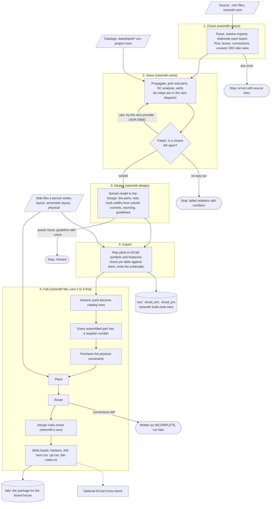
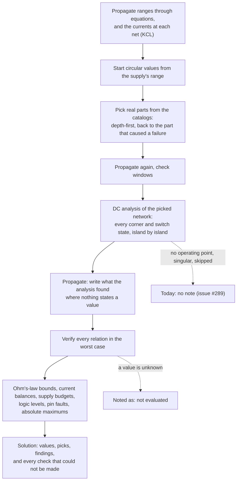
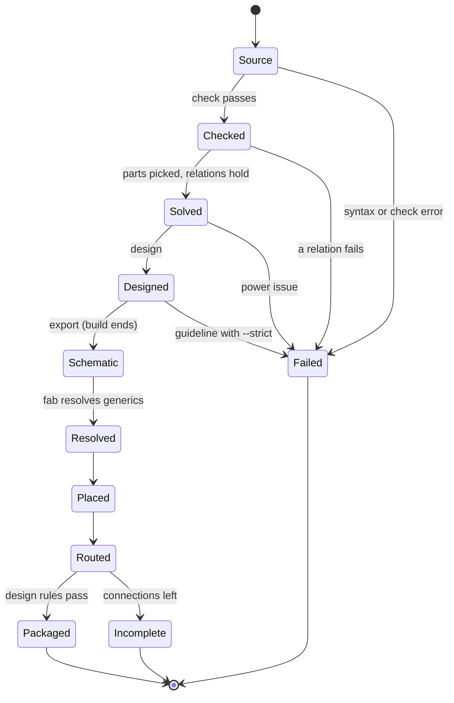

# The pipeline: from source to a board

What netsmith does with a design, in order. Nothing is kept between runs but one file: `build`,
`fab` and the editor each start from the source text and run the stages again. The files a
person writes beside a board (layout files, the physical file) are inputs. The files netsmith
writes are outputs, and no stage reads one back, except the pick lock (`<stem>.lock.toml`,
ADR 0100, proposed): `build` and `fab` write it when it is absent, and the solve stage then holds
each part to the row it names. `NETSMITH_TIMINGS=1` prints the seconds of each stage.

Written against `main` at `b504854`. Where a name in the code differs from the name a person
would expect, the diagram says so. The code is the authority: `crates/netsmith/src/lib.rs`
(`outcome_observed`) for stages 1 to 4, `crates/netsmith/src/fab.rs` (`fab_board`) for stage 5,
and `crates/netsmith-solve/src/solve.rs` (`solve_model`) for the solver.

## The stages

Stage 3 was called "lower" before 2026-11-09. Code, ADRs written before that date and old issues still
use the old word.

`build` runs stages 1 to 4. The editor runs the same stages on each edit but skips the KiCad
libraries, so it needs no KiCad. `fab` repeats stages 1 to 4 in the same process, then goes on
(ADR 0076 gives about 1.25 s for a 60-part board, optimised build; the router may take up to 300 s).

## Inside the solver

The solver is where the analysis happens. There is no separate simulation stage. It is the DC
pass, after the parts are picked.

Three points to hold on to:

- The DC analysis is worst case and static. It does not model time: no startup, inrush, ripple,
  AC or heating. ADR 0076 says why it does not run a circuit simulator.
- A check that cannot be made is never a pass. It becomes a note that says what is missing.
- Parts are picked before the analysis, and a few parts that read the analysis are picked after
  it (ADR 0076, amendment 7). The two overlap a little. The order above is the main line.

## One run as states

`Failed` ends the run with the errors. `Incomplete` writes the board and the Gerbers anyway, marked
INCOMPLETE, so a person can open the routed part, and the run still fails.

## What is decided late

- **The orderable part.** The solver judges a generic resistor or capacitor by its value. The
  catalog row that stands for it is chosen in stage 5 (ADR 0047). A part no row stands for stops
  `fab` by name.
- **Price and stock.** No stage knows them yet (issues #8 and #30).
- **Where parts go.** Only stage 5 places and routes. The schematic never depends on the layout.
