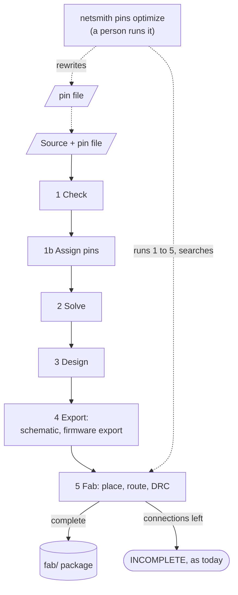
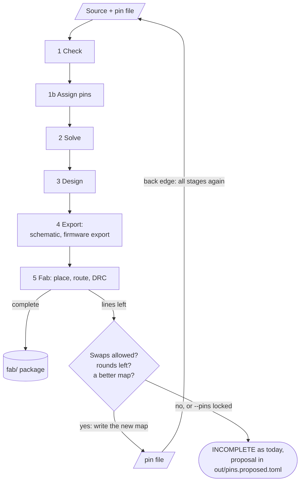
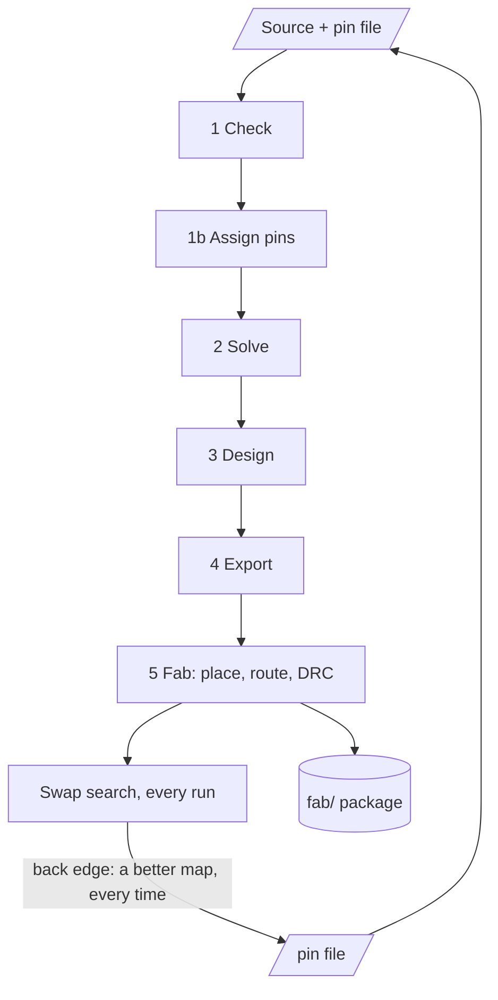

# Pin assignment by capability, with automatic optimization: options

Options note for issue #109 (pin assignment by capability) and issue #111 (the pin map for firmware), written on 2026-11-09 from the owner's decisions of 2026-11-04 and 2026-11-09. It decides nothing and builds nothing. Language-design choices are the owner's (`AGENTS.md`), so every spelling below is invented to compare options. Snippets marked `nsm-new` use constructs that do not exist. Snippets marked `nsm-fragment` use only constructs that exist today and are pieces of a file.

Nothing was run, built or parsed for this note. Every board, part and pin below is invented. Where a sentence says "I read" something, it is from the code or an ADR and was not executed. Anything I could not check is marked **unverified**.

Sources: issues #109, #111, #3 and #58; ADR 0032 and 0061 (the two files beside a source); ADR 0046 and 0071 (functions, kinds, `peripheral`, `shared`); ADR 0048 and 0064; `docs/PIPELINE.md`; `docs/LANGUAGE.md` ("Functions", "A peripheral on any pin", "Counts, functions and pins that share"); `crates/netsmith-check/src/faults.rs`; `crates/netsmith-pcb/src/{ratsnest,quality,route,anneal}.rs`; `crates/netsmith/src/fab.rs`.

## Where things stand

The owner has decided:

- Automatic assignment among pins declared interchangeable is wanted (2026-11-04).
- The solution lives in a file beside the layout file, as ADR 0032 splits requirements from solutions (2026-11-04).
- The pin map is stable between runs unless the design changes, because a changed pin is a firmware change (2026-11-04).
- The design must be able to optimize pins by itself, because some boards may not route at all without a pin swap (2026-11-09).

Open, and the subject of this note: the spelling of a request, the file's name and format, how a lock is written, the rule for stability, and when optimization runs.

Leans, each marked **Lean** where it appears. The owner may weigh them differently.

| Choice | Lean |
|---|---|
| Spelling of a request (1.1) | C: the capability is the type of a declared member, `.status: .u.GPIO` |
| Choosing an instance (1.2) | Both: name the function (`.u.UARTE1_TX`), or ask for the bus end (`.u.Uart`) |
| What makes pins interchangeable (1.3) | The `fn` lists and the request. No new declaration in the part |
| The file (2) | `<stem>.pins.toml`, keyed by request path, `lock` and `source` as in ADR 0032 |
| Stability (2.4) | A valid entry is never changed by a run. Only a new request, an invalid entry or the optimizer changes a pin |
| Tie-break (3.2) | The pin's path in byte order, not the table's row order |
| Optimization (4) | (b): `fab` swaps by itself when routing fails, bounded, and refuses under `--pins locked` |
| Link to #111 (4.8) | The firmware export reads the resolved pin map in the `Design`, not the file |

## 0. What the repository does today

Facts I read, which the options rest on.

- A part's `pins` table gives each pin its functions: `.pa2 bidirectional "PA2" "12" fn GPIO UART1_TX SPI1_SCK`. A board names the pin and chooses: `.u.pa2.function &= "UART1_TX"` (`docs/LANGUAGE.md`, "Functions"). A pin that is connected and has several functions needs one chosen. There is no default.
- `peripheral NAME on CLASS { ... }` offers a peripheral's functions on every pin whose row lists `CLASS`, so a row does not list every peripheral. A class is a function that rows list (`fn APP_GPIO`) (ADR 0071).
- `shared NAME limit N { ... }` limits how many peripherals, functions or pins are in use at once. It is judged for each instance of the part, before the solve, from the functions the board chose.
- A peripheral can be an end of a bus: `peripheral UARTE0 on GPIO as Uart { UARTE0_TX:output as tx ... }` (ADR 0064, `std/bus.nsm` has `Uart` with `tx` and `rx`).
- A function has its own kind (`UART1_TX:output`). The net rules judge a pin by the kind of the chosen function (ADR 0046).
- The `Design` already carries the chosen function of each pin: `netsmith_core::PartPin::function` (`crates/netsmith-core/src/lib.rs`).
- No part in `std/` and no example states `fn` (I searched `std/` and `examples/` for the word). `examples/schematic_bench` has `Mcu97`, 97 pins, none with a function. So no board in the repository could carry a request today, and a measurement of what swaps gain needs a part with `fn` lists first.
- **A gap found by reading, unverified by a run.** `functions_used_twice` in `crates/netsmith-check/src/faults.rs` (line 484) reports "function `X` is chosen on both `a` and `b`" for any function a board chose on two pins, with no exception for a class. The glossary says the same ("one function can be chosen on only one pin of a part"). A board that chooses `GPIO` on two pins of one part would be refused. A request for "any GPIO", given twice, would hit it. Section 1.4 says what to do.
- The word "assignment" is taken in the code: `netsmith_check::Assignment` is the choice of providers for generics (ADR 0068). This note says "pin assignment" and "pin map" to keep them apart.
- The router fails by leaving lines. `route_with` returns `Routing { left, stopped, tries }`, where `left` is a `Ratsnest` of lines that each name two pads (`Ratline::from`, `to`). `fab` writes the board anyway, marked INCOMPLETE, with `routing-failure.txt`, and the run fails (`crates/netsmith/src/fab.rs`). Issue #3 says the last connection fails on one fine-pitch module and gives suspected causes (pads sealed in pockets, hollow-centre vias, one-cell channels). It does not say whether a pin swap would fix them (unverified: no measurement in the repository).
- What is measured already: `Quality::of(board)` gives `hpwl`, `ratsnest` (length) and `crossings` (pairs of ratsnest lines of different nets that cross) from pad centres, and `Ratsnest::of(board)` is a spanning tree per net (`crates/netsmith-pcb/src/quality.rs`, `ratsnest.rs`). The annealer weighs crossings with `W_CROSSING = 1.0` (`anneal.rs`). The placer is a function of parts, nets and seed, so the same input gives the same board (ADR 0033).
- Two files sit beside a source today: `<stem>.pcb.toml` (ADR 0032) and `<stem>.sch.toml` (ADR 0061). Both are TOML with `version = 1`, one table per board keyed by the board's definition name, entries keyed by instance path (never by designator), written deterministically, with an unknown key an error. ADR 0032 makes a stale entry an error. ADR 0061 makes it a finding, because the schematic is a convenience.
- `docs/PIPELINE.md` says no stage reads back a file netsmith wrote. The files a person writes beside a board are inputs. The pin file would be the first one that `build` or `fab` writes and a later run reads.

## 1. The requirement in the source

A request names a capability instead of a pin. The tool answers with a pin.

### 1.1 Three spellings of a request

The part for the examples is invented. It is `Zmcu4`: pins that list `GPIO`, a few that also list `ANALOG` and their channel, and two UARTs on any `GPIO` pin.

```nsm-fragment
part Zmcu4 {
    peripheral UARTE0 on GPIO as Uart { UARTE0_TX:output as tx UARTE0_RX:input as rx }
    peripheral UARTE1 on GPIO as Uart { UARTE1_TX:output as tx UARTE1_RX:input as rx }
    shared UARTS limit 1 { UARTE0 UARTE1 }
    pins {
        .p00 bidirectional "P0.00" "3" fn GPIO
        .p01 bidirectional "P0.01" "4" fn GPIO
        .p02 bidirectional "P0.02" "5" fn GPIO ANALOG AIN0
        .p03 bidirectional "P0.03" "6" fn GPIO ANALOG AIN1
    }
}
```

**A. A statement declares the request pin.** A new statement names the pin, the capability and the part.

```nsm-new
pin .status: GPIO on .u          // declares the board's pin `.status`; any GPIO of `u`
.status ~ .led.a
pin .vbat: ANALOG on .u          // any analog input; UART TX: pin .tx: UARTE0_TX on .u
```

Cost: one new statement kind, next to `tie`, `shared` and `peripheral`. The name is stable and is the key in the pin file. A request is a pin of the board, so `~` and `.function` work on it as they do on a module's `.scl: Pin`. Two spellings of "a pin on a part" exist afterwards: `.u.p02` and `.status`, which is one more than today but each means one thing.

**B. The capability is a join target on the part.** No name is declared.

```nsm-new
.led.a ~ .u.GPIO                 // any GPIO of u, joined to the LED
.divider.mid ~ .u.ANALOG
.console.rx ~ .u.UARTE0_TX       // the TX line of UARTE0, on any pin that offers it
```

Cost: the smallest text, and it breaks a rule of the language. `~` joins the things it names, so two joins to `.u.GPIO` would put the LED and the divider on one net. B needs "each use of a capability is a new pin", which makes the meaning of a path depend on where it is written. It also has no stable name: the key in the pin file would have to come from the other end (`led.a`), which changes when a net gains a pin. **Not recommended.**

**C. The capability is the type of a declared member.** The existing `.name: Type` form, with a type that names a function of an instance.

```nsm-new
.status: .u.GPIO                 // a pin of `u` that offers GPIO; the tool picks it
.status ~ .led.a
.vbat:   .u.ANALOG               // analog input; UART TX: .tx: .u.UARTE0_TX
```

Cost: no new statement, one new idea: a type that is a function of an instance (`.u.GPIO`). It must resolve through a path, so the checker needs a rule for "the type of a declaration is an instance's function". Errors reuse today's text ("that function is offered only on ..."). The name `.status` is the key. It works for a module the same way, a module's own `.scl: Pin` being a request whose pin the board forwards (`.hub.scl.function`, ADR 0071).

**Lean: C.** It keeps one declaration form (ADR 0001), gives every request a name, and adds no keyword. A is the fallback if a type that names an instance's function is not acceptable.

### 1.2 Choosing a peripheral instance

Two cases: the author wants UART1, or the author wants a UART and does not care which.

**I1. Name the function.** `.tx: .u.UARTE1_TX` asks for the TX line of UARTE1 on any pin that offers it. The instance is named, and `shared` still judges it. This is also how a firmware author usually thinks: the debug UART is UART1. Cost: none beyond 1.1. It does not choose an instance for the author.

**I2. Ask for the bus end.** Peripherals that state `as Uart` are all ends of `Uart` (ADR 0064). A request for the end lets the tool pick the instance and both of its pins:

```nsm-new
.dbg: .u.Uart                    // a Uart end of u: the tool picks UARTE0 or UARTE1 and two pins
.dbg ~ .console.uart             // joins the bus, as an interface does today
```

Cost: the type `.u.Uart` is a role of an instance, not a function, so the rule for the type in 1.1 gets a second case. The search must keep `tx` and `rx` on one instance and honour `shared`. The map must record the instance (`UARTE0`), because firmware needs it. Only parts that state `as Uart` can serve it. This looks like a provider choice (ADR 0068, "an interface picks a part that provides it"): unverified whether the same mechanism could carry it.

**Rejected: a family function** (`UART_TX` standing for each instance's TX). Two requests, `.tx` and `.rx`, could land on two different instances. Only a request for the whole end says "one instance".

**Lean: both I1 and I2.** I1 needs nothing. I2 needs the type rule, and is worth it only when a board really does not care which UART it gets.

### 1.3 What the part must declare

Three questions: who may use a pin, which pins may swap, and what the part must add.

**Pins a request may use.** The existing `fn` lists are enough. A request for `GPIO` may use every pin whose row lists `GPIO`. A request for `UARTE1_TX` may use every pin that offers it, through a row or through `peripheral ... on CLASS`. The checker already knows this set, because it prints it in the message "that function is offered on every pin that lists `GPIO`".

**Analog needs a convention, not a feature.** A row lists a class `ANALOG` and its channel (`fn GPIO ANALOG AIN0`). A request for `ANALOG` may use any such pin. Firmware needs the channel, so the map must record `AIN0`, not only `ANALOG`. That is a rule for the owner (Q14). It adds no syntax in the part.

**Pins that may swap.** Three options.

- **P1. Only requests move; the `fn` lists decide.** A pin the source names (`.u.p02 ~ ...`) never moves. A pin given to a request may move to any free pin that offers the same capability, or swap with another request's pin when both requests are still satisfied. The part says nothing new. Cost: two pins whose rows are alike but whose datasheet differs in something the row cannot state (5 V tolerance, drive strength, a pin next to a crystal) would be treated as equal. The fix is in the part: state the difference as a function (`fn GPIO LOW_NOISE`), which the language can already do. "Libraries state only what is always true" holds.
- **P2. The part declares sets.** A line like `interchangeable PORT0 { .p00 .p01 .p02 }`, as `shared` is a line. Cost: a second statement of what the rows already say, so the two can disagree, and a new check that every member of a set offers the same functions. Two places then state the capability of a pin, against ADR 0001.
- **P3. The board marks what may move.** The board lists the pins its optimizer may touch. Cost: it repeats what a request already says (a request is a permission to move).

**Lean: P1.** Add P2 only when a real part shows a difference that `fn` cannot state.

### 1.4 What the checker still refuses

After a request has a pin, the same rules run on the result. I read the rules as they are; the code that applies them to a resolved request does not exist.

| What | How it is refused |
|---|---|
| A pin that cannot offer the function | A request for a function that no pin of the part offers is an error at the request's line, with the text of today's "cannot be" message. An entry in the file whose pin does not offer it is an error at the file's line when it is locked (2.4). |
| Two uses of one pin | A pin the source names, a locked entry and another entry on one pin is an error that names both. The search never gives one pin to two requests. |
| A function that disagrees with its net | The net rules of ADR 0046 judge the kind of the chosen function. A request has one function, so a disagreement does not depend on the pin: report it once, at the request ("`status` is `UARTE0_TX`, an output, on a net that another output drives"), not once for each candidate pin. |
| Shared hardware | `shared` is a constraint of the search (3.2), and the rule still runs on the result. |
| The same function on two pins | See below. |

**The `functions_used_twice` gap.** Two requests for `GPIO` on one part resolve to two pins that both chose `GPIO`, which the rule refuses today. Options: (1) exempt a class, a function that rows list and peripherals are `on`, from the rule; (2) make a request for a class choose nothing, so the pin stays plain; (3) leave the rule and write the function of each GPIO by hand. **Lean: (1).** A class names what a pin can be, not one use. This changes a check, so it is the owner's (Q9).

## 2. The pin file

### 2.1 Name and format

**Lean: `<stem>.pins.toml`** beside the top-level `.nsm` file (`src/main.nsm` has `src/main.pins.toml`). It copies ADR 0032 and 0061: plain TOML, optional, `version = 1`, one table per board keyed by the board's definition name, an unknown key an error, boards in name order and entries in byte order of their keys, written the same way every time so that `parse(to_text(x)) == x`. Another word is possible (`.pinmap.toml`). `.pin.toml` is too close to `.pcb.toml` at a glance.

The file holds a solution, not a requirement (ADR 0032, ADR 0048). The request is in the source.

### 2.2 What it holds

```toml
version = 1

[Sensors.pins.status]            # the request's path: `status`; in a module `hub.scl`
pin = "p02"                      # the pin's path in the part, not its pad
function = "GPIO"
lock = true
source = "hand"

[Sensors.pins.vbat]
pin = "p03"
function = "AIN1"                # the channel, if the owner wants it recorded (Q14)
source = "auto"

[Sensors.pins.dbg]               # a request for the bus end (1.2, I2)
peripheral = "UARTE1"
pins = { tx = "p00", rx = "p01" }
source = "auto"
```

- **The key is the request's path**, as ADR 0032 keys a part by its path. It does not change when a designator is renumbered.
- **The value is the pin's path in the part (`p02`), not its pad.** The pad changes with the package (`"5"` in one, `"A3"` in another) and the schematic and the fab files take it from the pin table. The path is what the language uses.
- `lock` and `source` are ADR 0032's keys with the same meaning: `source` is `"hand"` for a pin a person chose and `"auto"` for the tool's, kept as written.
- The file holds only requests. A pin the source names is in the source, so one fact has one home. The firmware export (4.8) joins both.
- The file may also write the pad and the datasheet name for a reviewer, as keys that are read and ignored. That repeats two facts that can go stale (Q15). A comment would carry them, but a comment is not kept when the editor rewrites the file (ADR 0032's known limit).

### 2.3 How a person locks a pin

Three ways, none new:

- Edit `lock = true` in the file.
- In the editor, lock the pin on the pin map (section 5), which writes the same line.
- Write the pin in the source (`.led.a ~ .u.p02`). That is a requirement, not a lock. It is the precedent of ADR 0032 and 0048: a requirement says what must hold and is reviewed as a circuit change, and a lock says "keep this solution" and is reviewed as a change of the file.

A locked entry that no longer holds (the part's table lost the function, the pin is now named by the source) is an error at the file's line, because a lock is a promise to firmware. An unlocked entry that no longer holds is a finding, and that request is picked again (2.4, rule 4).

### 2.4 The rule for stability

1. A run never changes a valid entry. An entry is valid when its request exists, its pin offers the capability, no other request or source line holds the pin, and `shared` still holds.
2. A request with no entry gets a pin, found as in 3.2 with every valid entry and every source-named pin held fixed. The entry is written.
3. A request that was deleted loses its entry on the next write. Other entries do not move up, so no pin shifts to fill a hole.
4. An unlocked entry that is no longer valid is picked again, with a finding that says why and which pin it was. A locked one is an error.
5. If a new request can only be served by moving an unlocked entry, the run fails with a message that names the move (3.3). It does not move the other pin by itself. Only the optimizer moves a valid entry (section 4), or a person does (Q10).
6. The file never depends on the layout, except through the optimizer, and the optimizer is the only writer that reads the layout.

Who writes the file (Q8, **lean: `build` and `fab` write it when rule 2 or 4 changed it**). The model is `Cargo.lock`: written when absent or out of date, and `--locked` fails if it would change. CI would run `--locked`. The editor does not write on each keystroke: it assigns in memory and writes on save, as it saves the source. `docs/PIPELINE.md` needs a line saying that the pin file is read and written by a run.

A stale entry (a request that is gone) can be an error, as ADR 0032, or a finding, as ADR 0061. **Lean: a finding for an unlocked entry, an error for a locked one** (Q8).

## 3. Where assignment sits in the pipeline

### 3.1 Before the schematic, and before the solve

The schematic shows pin numbers, so pins must be known before stage 4 (Export). They must be known before stage 2 (Solve) too: `shared` is judged before the solve from the chosen functions, and the logic-level and absolute-maximum checks read the kind and the limits of the chosen function (ADR 0046). So pin assignment is a step at the end of stage 1 (Check), before the solve. It reads the elaborated board, the parts' pin tables and the pin file. It does not need layout, and it cannot use layout: placement comes after the schematic.

Proposal: resolve each request into the facts the source would have stated (`.u.p02.function &= "GPIO"`, and the pin joined to the net), and then run the existing checks unchanged. One meaning, and every message already written keeps working, though a message must point at the request's line, not at a statement nobody wrote. **Unverified:** where in `netsmith-check` the model is built, and whether the resolve can sit between the elaboration and the pin rules. I did not read `model.rs` beyond its names.

### 3.2 How it is decided: a search, deterministic

It is a small constraint search over capabilities. Pins are few (tens to a few hundred per part).

- **Variables:** the requests, in the byte order of their paths.
- **Domain of a request:** the pins that offer its capability, in the byte order of their paths, minus pins the source names and pins of locked entries.
- **Constraints:** one pin per request; `shared` limits; one instance for the lines of a bus end (1.2); a pin's direction is not a constraint of the search (1.4).
- **Search:** depth first, in that order, taking the first solution. The result is the least pin map in that order, so the same input gives the same output, and nothing depends on a hash map.
- **Ties:** the order of the pin's path in byte order, not the table's row order. A result that depends on the order of rows would break "statement order never matters" (`docs/DESIGN-RULES.md`). The owner suggested declaration order. I flag the rule and ask (Q3). In byte order `p0_10` comes before `p0_2`. A natural order (digits as numbers) is a variant. The first run's result is then kept by the file, so the tie-break matters once for each request.

The first pin map is arbitrary with respect to routing. That is the cost of choosing without layout, and it is what section 4 is for.

### 3.3 Messages when it cannot be satisfied

Wording is invented. The house style names the request, the part, and every pin that was tried and why not.

```text
error: `vbat` asks for ANALOG on `u` (`Zmcu4`), and no pin of `Zmcu4` offers it; the functions its rows list are GPIO, ANALOG, AIN0 and AIN1
```

That is the first case: nothing offers it. It is today's "that function is offered" text with the request in place of a pin.

```text
error: `vbat` asks for ANALOG on `u`, and every pin that offers it is taken: `u.p02` by `status` (locked, main.pins.toml:3), `u.p03` by `.u.p03 ~ .sense.a` (main.nsm:21); moving `status` to `u.p00` would free `u.p02`
```

The second case: nothing is free. It names who holds each candidate and says if the holder is a lock or the source (cannot move) or an unlocked entry (could move), and names the one move that would work if there is one (rule 5 of 2.4).

```text
error: `dbg` asks for a `Uart` end of `u`, and `UARTS` allows 1 of UARTE0, UARTE1 at a time: UARTE0 is used on `u.p00` as UARTE0_TX (main.nsm:14)
```

The third case: `shared`. It reuses the text of ADR 0071's message. A message names the request's line in the source, and, when the cause is in the pin file, its line (`main.pins.toml:3`).

## 4. Automatic optimization

The owner's new requirement: the design must be able to move pins by itself, because some boards may not route without it.

### 4.1 Why it is a back edge

The measures that say a pin map is bad, crossings, ratsnest length and lines left, exist only after placement and routing, which are stage 5. The pins are needed in stages 2 to 4. The pipeline in `docs/PIPELINE.md` runs one way. Optimization needs an edge from stage 5 back to the pin file.

The edge goes through the file, not through memory. Each pass starts from source and file and runs every stage again, as every run does today ("nothing is kept between runs"). So no stage is run out of order. The loop is around the pipeline. The pipeline already has one retry inside a stage: the solver tries the next provider when one fails (ADR 0068, in the first diagram). This one is across stages.

### 4.2 The search all options share

- **Candidates:** the unlocked requests of one part. A **move** puts a request on a free pin that offers its capability. A **swap** exchanges two requests' pins when each request is satisfied by the other's pin. Source-named pins and locked entries never move. A move or swap that breaks `shared` is not a candidate.
- **Where to look first:** the pins whose nets have lines left (`Routing.left`, each line names two pads), then the pins of the most crowded part. This is a proposal: unverified whether it finds the swaps that matter.
- **How to score cheaply (unverified):** hold the placed parts still, change which net each swapped pad is on, recompute `Ratsnest::of` and `Quality::of`, and keep a candidate that lowers `crossings`, ties broken by `ratsnest` length. It is a spanning tree per net and a pair count, with no routing. I did not measure its time.
- **How to confirm:** after a round, place again (positions were chosen for the old nets) and route. Keep the new map only if the lines left do not increase and crossings do not rise. Otherwise keep the old map and stop.
- **Stop:** at a bound on rounds (my guess: 3), at a time budget shared with `--route-timeout` (a route may take up to 300 s, `DEFAULT_ROUTE_TIMEOUT` in `fab.rs`), when a round finds no improving candidate, or when the board routes completely.
- **Determinism:** candidates are tried in path order and the placer is seeded, so the same source, file, locks and seed give the same new map. The seed in `.pcb.toml` therefore changes the pin map, which is true of the placement already.
- **Not moved:** a pin the source names, a locked entry, a request that has no other pin to go to.

### 4.3 Option (a): only by an explicit command

`netsmith pins optimize` (name invented) runs stages 1 to 5, searches, and rewrites `main.pins.toml`. `build` and `fab` never change a pin.



- **Loop and stop:** 4.2. The person runs it and runs `build` and `fab` again.
- **Firmware:** nothing changes unless the person runs the command. The diff of `main.pins.toml` is the change, and the firmware export (4.8) changes with it. A CI check needs no flag: `build` and `fab` never write pins.
- **What the person sees:** a report ("swap `status` p02 and `vbat` p03: crossings 14 to 9, lines left 6 to 0") and a diff of the file.
- **Cost in the pipeline:** none. The stages stay one-way. A board that does not route ends INCOMPLETE as today, and the message must say "run `netsmith pins optimize`". Cost for the person: a manual step, and "some boards may not route without a swap" becomes "and the person must know to ask".

### 4.4 Option (b): `fab` swaps when routing fails

`fab` runs the search by itself when routing leaves lines (and, if the owner sets a bound, when crossings pass it), writes the changed pin map, and runs again from stage 1, so that the schematic and the firmware export are made again from it.



- **Loop and stop:** 4.2. Each round is a full pass of stages 1 to 5. At most R rounds. The best map is kept: if the last round is no better, the previous map stands.
- **Firmware:** a changed pin map is a changed firmware input. `fab` must say so: a first line in `fab-notes.txt` ("pin map changed by this run: `status` p02 to p05; the firmware export changed"), as ADR 0046 does for designators in a package already ordered. A package ordered with an older map no longer matches the firmware built from the new one.
- **How a run is made to refuse:** `--pins locked` on `fab` (and `pins = "locked"` in `netsmith.toml`) fails routing as today, and writes the proposed map to `out/pins.proposed.toml`, never to the source folder. The precedent is `--constraints warn|error` and `guidelines = "error"` (`docs/LANGUAGE.md`, "Commands" and "Projects and netsmith.toml"). CI runs `--pins locked`. After the first firmware release the team sets `pins = "locked"`, and no run moves a pin again until someone changes the setting.
- **What the person sees:** a progress line for each round, a diff of the file, the lines of `fab-notes.txt`. The diff is the same as in (a).
- **Cost in the pipeline:** up to R more passes of stages 1 to 5. Stages 1 to 4 took about 1.25 s for a 60-part board (`docs/PIPELINE.md`, ADR 0076). Placement time is not given there (unverified). A route can take up to 300 s, so a failing board can take R times as long, which the shared time budget bounds. Cost for the design: `fab` now writes a file in the source folder. Every other output of `fab` goes to `fab/`.
- **Trigger on crossings:** off by default. A crossing count is a proxy, and a board that routes with many crossings has no need of a firmware change. A bound on crossings is a setting the owner can add later.

### 4.5 Option (c): always

`fab` runs the search on every run, for every unlocked request, whether or not routing failed.



- **Loop and stop:** 4.2, once or R times for each `fab`.
- **Firmware:** the pin map can change after any edit of the design, a resistor value included, because placement changes and so do the scores. This breaks "stable between runs unless the design changes", unless every pin is locked, which makes it (b) with extra work.
- **What the person sees:** a diff at nearly every run.
- **Cost:** every `fab` runs the search and a second place and route, so a clean board takes about twice as long. `build` has no placement, so it cannot do it, and the schematic from `build` would show the map of the last `fab`.
- **Not recommended.** It buys nothing the owner asked for: no board is helped that (b) would not help, and the firmware pays for it.

### 4.6 Option (d): pin moves inside the placer

A variant of (b), not a fourth trigger. The annealer already has a "swap two parts" move (ADR 0033). A move that swaps two requests' pins would use the cost it has (wire, crossing, cohesion), with no outer loop and no extra route for scoring. Cost: the state of the annealer is poses only, and a pin move changes `BoardNet` pads, so the incremental cost needs care (**unverified**). The placer cannot see routing failures, only crossings and wire length. The map would then also depend on the placer's seed and weights. The back edge to the pin file stays: the schematic is drawn before the placer. **Lean: not first.** The loop in (b) can be built from what exists, and (d) can replace its scoring later without changing the file.

### 4.7 Recommendation: (b), built on the engine of (a)

- One engine, two triggers: the command (a), and `fab` on a routing failure (b).
- `pins = "auto"` by default, `"locked"` by a setting or by `--pins locked`, so a team freezes the map once firmware exists, and CI refuses a change.
- A trigger on routing failure only. A crossings bound later, if a measurement shows it helps.
- Only requests move, within what their capability allows. Locks and source-named pins never move. A bound of R rounds and a time budget.
- A change to the pin map is loud: a diff of the file, a line at the top of `fab-notes.txt`, and an export that differs.

Why not (a) alone: the owner wants boards that do not route to route. Why not (c): it breaks stability for no gain.

### 4.8 How this relates to issue #111: one file feeds both

There are two files and one map.

- **The pin file** (`main.pins.toml`) is an input for people and for netsmith: requests, their pins, locks. Only requests are in it.
- **The resolved pin map** is what the checker's resolve step produces: every pin of every part that the board uses, with its net, function, direction (the kind of the function) and whether the source or the file chose it. It is a function of the source and the pin file. The `Design` already carries the chosen function for each pin (`PartPin::function`), so the exporters of #111 read the `Design` and need no new input.
- **The firmware export** of #111 (a data file, a C header, a Zephyr overlay) is an output written from the resolved map. It lists all pins, not only requests, in sorted order with no timestamp, as #111 asks. A diff of the export is what a firmware author reads. A diff of the pin file is what a hardware reviewer reads.
- The schematic (stage 4), the fab pads (stage 5) and the firmware export read the same resolved map. A swap by the optimizer changes the file once, and all three follow.
- CI for #111 ("fail when the exported map differs from the one the firmware committed") works unchanged with (b): `fab --pins locked` cannot change the map, and the export check catches any other change.
- **Naming a signal for firmware** is the net's name (`.pos.net &= "3V3"`) or the request's name (`status`). Which one firmware sees is #111's choice and is not decided here. A request's name is stable and chosen by the designer, which is a reason for (A) or (C) over (B).

## 5. The editor

A later concern, a few lines. The editor shows the pin map of the selected part: each request, its pin, its pad, its function, a padlock for `lock`, and the source (`hand` or `auto`). A click on the padlock writes `lock = true`. A swap preview lists the pins a request could move to (free pins and swap partners that keep both requests satisfied), and for each shows the change in crossings and ratsnest length on the placed board before anything is written, using `Quality::of` on a copy. A drag of a request to another pin writes a `source = "hand"` entry. The editor assigns in memory as the source changes and writes the file on save. The editor's Ref comparison (ADR 0059) can show the pin file's diff against a git ref the way it shows the layout file's.

## 6. Questions for the owner

Each takes one word or one choice.

| # | Question | Choices (lean first) |
|---|---|---|
| Q1 | Spelling of a request (1.1) | C (declared member typed by the capability), A (a `pin` statement), B (a join target, not recommended) |
| Q2 | Choosing an instance (1.2) | Both I1 and I2; I1 only |
| Q3 | Tie-break among equal pins | Path in byte order; path in natural order; table order |
| Q4 | What makes pins swappable (1.3) | P1 (`fn` lists and the request); P2 (a set the part declares) |
| Q5 | The file's name | `<stem>.pins.toml`; another word |
| Q6 | Does the file also list pins the source names? | No; yes |
| Q7 | Do `build` and `fab` write the file when they pick a pin? | Yes, with `--locked` refusing; no, only a command |
| Q8 | A stale entry (its request is gone) | Finding for unlocked and error for locked; always an error; always a finding |
| Q9 | The rule "one function on one pin" and a class (1.4) | Exempt classes; a class request chooses nothing; leave it |
| Q10 | A new request that needs a pin an unlocked entry holds | Fail and name the move; move the other pin |
| Q11 | Optimization (4) | (b) on the engine of (a); (a) only; (c); (d) |
| Q12 | The default of `fab` | `auto`; `locked` |
| Q13 | The trigger | Routing failure only; also a crossings bound |
| Q14 | What the map records for a class request such as `ANALOG` | The pin's channel (`AIN1`); the class only |
| Q15 | Write pad and datasheet name beside the pin in the file? | No; yes (read and ignored) |
| Q16 | Bound on rounds | 3; another number |

Terms to add to `GLOSSARY.md` if the owner accepts this direction: _Pin request_, _Pin file_, _Pin map_. None is written here.
