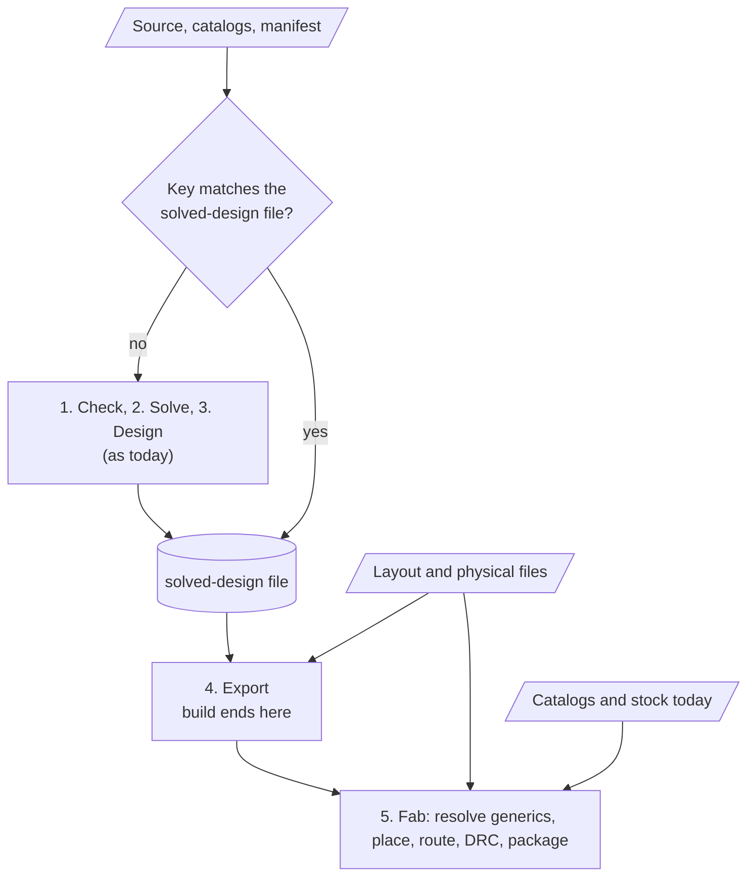

# A solved-design file and a pick lock (options)

Options for the owner. It decides nothing and builds nothing. Formats, file names and the words
below are the owner's to choose (`AGENTS.md`); every name here is a placeholder. Vocabulary
follows `GLOSSARY.md`. Written against `main` at `7869039`. Nothing was built or run for this
note: every figure of time is quoted from a source file, and what I could not verify is marked
**unverified**.

## Summary

- `build`, `fab` and the editor each start from the source. `fab` runs stages 1 to 4 of
  `docs/PIPELINE.md` again before it places. There is no stage boundary a program can read back:
  the exporters take a `Design` that only the solver's run can make.
- Time is not the main problem yet. ADR 0076 and the root `Cargo.toml` quote about 1.25 s for a
  60-part board (optimised solver), but those are not our figures for `fab`, and the two sources
  disagree on the debug build (14 s, 7.4 s). Measure first (section 5).
- The real problem is reproducibility. The solver takes the first catalog row that works, in file
  order, and `fab` chooses the orderable row for a generic part by library class, file order and
  the stock a provider says. A catalog edit, a solver change or a stock answer can change a pick
  with no change to the source, and nothing says so.
- Option A, a **solved-design file** (the `Design` and its sourcing, written once, read by `build`
  and `fab`), is a stage boundary. It needs serde on the types of `netsmith-core` first, which
  have none today.
- Option B, a **pick lock** (a committed file: part path to catalog row), is the answer to
  reproducibility. It is small, diffable and useful without A.
- I recommend B first, then A for `fab` only, and no per-module incremental solving unless
  measurement asks for it.

## 1. What the code holds today

### The values a run makes

| Value | Where | Holds | Serde |
|---|---|---|---|
| `Outcome` | `crates/netsmith/src/lib.rs` | `boards: Vec<Built>`, `systems: Vec<SolvedSystem>`, `panels: Vec<PanelSpec>` | none |
| `Built` | same | the `design`; `sourcing`; `catalog_heights`; `rechecks` (a closure that solves again); the `schematic` and `project` text (empty without KiCad libraries); `report`; `notes` with `note_causes`; `providers`; `guidelines`; `power`; `trace` | none |
| `Trace` | same | the solved `Model`, the `Sources` (all source texts), `origins` (the instance of each part) | none |
| `Design` | `crates/netsmith-core/src/lib.rs` | `name`, `parts` (refdes, kind, provides, value, package, path, pins), `nets`, `process`, `features` (widths, outline, cutouts, pours, keepouts, heights, protrusions, hand-fitted, labels, constraints, offsets, `line_texts`), `interfaces`, `notes` | none |
| `Solution` | `crates/netsmith-solve/src/solve.rs` | the solved `Model`, `picks`, `unresolved`, `deferred`, `circular`, `open_circles`, `seeded`, `diagnostics`, `not_evaluated`, `trials`, `work`, `unconstrained`, `unstated`, `current_bounds`, `dc`, `net_currents`, `default_assembly` | none |
| `Pick` | same | `part` (an `InstId`), `catalog`, `candidate` (the row's name), `label`, `lcsc`, `mpn`, `library`, `assembly`, `height`, `generic`, `rejected`, `count` | none |
| `Model` | `crates/netsmith-check/src/model.rs` | instances, fields with their ranges, relations (shared by `Arc`), nets, balances, chains, mates, ground groups, and more | none |

Serde derives exist only at the edges: the editor's API types (`netsmith-editor/src/api.rs`,
`api/compare.rs`, `api/hints.rs`), `Manifest` and `SupplyConfig` (`project.rs`), the KiCad mapping,
`Layout` (`netsmith-pcb/src/layout.rs`) and `order.rs`. `netsmith-core` has no dependencies at all
(`crates/netsmith-core/Cargo.toml`). `serde` and `serde_json` are in the workspace already
(`netsmith`, `netsmith-editor`, `netsmith-pcb`, `netsmith-kicad`); no hash crate is (`uuid` with
`v5` is in `netsmith-kicad`; the editor's `code_fingerprint` uses `DefaultHasher`, whose output
Rust does not promise to keep between releases).

What the stages need from these values:

- `export` (KiCad schematic and `.kicad_pro`) reads the `Design`, the `Sourced` rows and the KiCad
  libraries. It uses the model and the sources only to name the lines of the physical file in
  messages (`constraints::name_sources`).
- `fab_board` (`crates/netsmith/src/fab.rs`) reads `built.design`, `built.sourcing`,
  `built.rechecks`, the layout file and the libraries, plus `catalogs` for `resolve_generics`
  (stage 5's "generic parts become catalog rows"). `no_supplier::find` reads `built.trace`.
  **Unverified:** that nothing else of `Trace` is read on the way; I read the calls named, not
  every line of `fab_board`.
- The editor reads much more. `Trace.model` feeds the power tree (`editor/power.rs`), the
  schematic drawing (`netsmith-view`), the solved-value cards (`editor/solved.rs`), the compare
  view (`editor/compare.rs`) and the problem locations. So a file that holds the `Design` is enough
  for `build` and `fab`, and not for the editor.

### Is the output deterministic?

Evidence for:

- Parts get designators in natural path order (`netsmith-design/src/lib.rs`: `ids.sort_by(...)`,
  ADR 0048 item 11). The design uses `BTreeMap` for counters and banks; `Features::line_texts` and
  `Catalogs` are `BTreeMap`s.
- KiCad object ids are UUIDv5 of a name (`netsmith-kicad/src/schematic.rs`, `uuid_for`).
- The search budget is counted in `work` units, not seconds (`Solution::work`).
- Tests: `building_twice_gives_identical_files` (`crates/netsmith/tests/build.rs`, the LED board),
  `the_pick_is_the_same_on_three_runs_...` (`tests/providers.rs`),
  `the_same_inputs_give_the_same_board` (`tests/height.rs`, `tests/constraints.rs`),
  `the_same_input_gives_the_same_bytes` (`netsmith-fab/src/tests.rs`, the package step only).

Evidence against, or not settled:

- `HashMap` and `HashSet` are in about 60 source files by a rough grep (it includes code only
  tests use), about 24 of them in the solver and the checker (`solve.rs` alone has dozens: `fed`,
  `job_of`, `equations_of`, `from`). Rust seeds each map's hasher differently, so any iteration
  that reaches an output shows as a flaky diff. I did not audit the uses: some of the names
  suggest membership tests, and `solve.rs` has many `sort` calls, but I read no use to the end.
  **Unverified** for the solver, the checker's model and the DC pass.
- The determinism tests are on small boards, in one process. Nothing runs a 60-part board twice in
  two processes and compares the whole `Design`. **Unverified**: whether such a run differs.
- The router stops after a wall-clock limit (`--route-timeout`, 300 s by default). A `fab` run that
  hits it gives a different board on a slower machine. That is outside the solved-design file, but
  it limits what "the same `fab` output" can mean.
- `resolve_generics` asks the provider's stock, and the supply cache keeps an answer for
  `cache_hours` (the list below). The orderable row of a generic part depends on the day.

A solved-design file would be only as stable as this, so the first piece of work is a test that
builds one large board twice, in separate processes, and compares everything written (section 5).

### What picks depend on

A pick is the first row, in catalog order, that fits and survives the relations (ADR 0022, 0047).
The inputs are:

1. Every `.nsm` file reached by imports, and the physical file and schematic layout file beside
   each (`Target::watched`, `Project::loader_with`).
2. The standard library and standard catalogs. Both are compiled into the binary
   (`include_str!` of `std/` in `netsmith-check/src/loader.rs`, `data/jlcpcb/considered.csv` in
   `netsmith-solve/src/jlcpcb.rs`). The tool's version covers them; a development build at the
   same `0.1.0` does not. **Unverified:** whether the binary carries a build id.
3. The project's catalog files (`Project::catalog_files`: `catalog_dirs` folders in the
   manifest's order, files by name, then `catalogs`).
4. The manifest: `assembly`, `guidelines`, `constraints`, `series`, `supply` (`Project::catalogs`).
5. Stock, when `[supply]` is set. `Catalogs::with_availability` carries it. The solver itself
   does not read it (I found no read of `availability()` in `netsmith-solve` beyond the
   `catalog.rs` accessor); `resolve_generics` passes it to `resolve`, and `stock::notes` reads it.
   A `stock` cell of `0` in a catalog file is a file input and already part of 3. The cache is `supply/<provider>.csv` in
   `$NETSMITH_CACHE_DIR`, else `$XDG_CACHE_HOME/netsmith`, else `~/.cache/netsmith`
   (`supply/cache.rs`).

### The two caches that exist, so they are not mixed up

- **The supply cache** (`supply/cache.rs`) keeps a provider's answers about price and stock, in a
  CSV, by part and channel, with a fetch time. It is a cache of a fact about the outside world. It
  is not design data, and it holds no solver result.
- **The editor's caches** (`editor/mod.rs`, `State`) live in memory for one server run: the file
  stamps (modification time and length), `code` (a fingerprint of each `.nsm` file's tokens, so a
  change to a `//` comment does not analyse again), the snapshot of the last analysis, placed and
  routed boards by name (`pcb`), what `fab` wrote, and the compare cache by commit hash
  (`compare::Cache`). Any change to a watched file analyses the whole project again. There is no
  cache per board or per module, and none on disk.

`Catalogs::with_pin(path, row)` already holds a part to one row. `Rechecks` uses it to ask "would
the board still solve with this alternative?" (`resolve.rs`). It is not a lock as it stands: it
drops the design's statements about the row's numeric columns (`relax_pinned`) and offers only a
non-generic row (`c.generic.is_none()`). A lock needs the design's statements kept and the locked
row judged by them (section 3).

## 2. Option A: a solved-design file (a stage boundary)

### What it holds

The least that lets `build` and `fab` run without the solver:

- each board's `Design` (everything in the table above);
- the `Sourced` rows (`netsmith-design`), with the `generic` each part still waits on, because
  `fab` resolves generics against today's catalogs and stock (ADR 0047);
- the notes with their causes, the guidelines, `power` issues, `providers` and `catalog_heights`,
  so the messages of a `build` from the file equal the messages of a solve;
- for a system, its members and the ground findings it reports;
- `panels` as `PanelSpec`;
- the key (below) and the tool version.

It leaves out the `Model`, `Sources` and the solver's findings lists. Without them these do not
work from the file alone: the editor's power tree, the schematic drawing, the solved-value cards,
compare, and `rechecks` (a re-solve). Two ways to treat that:

- **A1, build and fab only.** The editor keeps analysing from source, as today. Smallest file,
  smallest list of types to make serializable. The editor remains the one place where the whole
  pipeline runs, and so the place that finds a change of solver output.
- **A2, everything.** The file also holds the model. That is serde on `Model` (instances, fields,
  relations in `Arc`, nets, balances, chains, mates), on `Domain` and `Quantity`, and on the
  checker's ids. Large, and its format becomes part of every solver change. I do not recommend it.

### Format

| Option | For | Against |
|---|---|---|
| JSON (`serde_json`, already a dependency; sorted keys, one object per line for lists) | Every language reads it. A review shows a diff if it is committed. No new dependency. | Floats must round-trip: write them with the shortest exact form (`serde_json` does, with `ryu`) and test it. Larger than binary. Easy to edit by hand and break the key. |
| TOML (as the layout files are, ADR 0032) | One family with `*.pcb.toml` and `*.sch.toml`; hand-readable. | Poor fit for deep, long tables of parts and pins. `toml` writes tables in an order that needs care for a stable diff. |
| A binary form (`bincode`, `postcard`, or a hand-rolled one) | Small, fast to read. | No diff, a new dependency, and a layout that breaks at each field change. |

A solved-design file is derived data. Nobody should edit it, and a review should not need to read
it unless it is committed. I recommend JSON, with a `version` field first, lists in the design's
order, maps as sorted arrays of pairs, and floats as numbers `serde_json` prints exactly. A change
of `version` makes the file stale.

### Key

The file is valid only for the inputs it was made from. A key that covers all of them:

1. the text of each source file the board imports, and the physical file and schematic layout file
   beside each; read through `Loader` (so the std library is one entry, named by the tool
   version), not a list kept by hand;
2. each project catalog file, in the order `Catalogs` reads them, and the manifest fields that
   `Project::catalogs` passes on (`assembly`, `guidelines`, `constraints`, `series`, `supply`);
3. the tool version, plus a build id if there is one (unverified, see section 1);
4. not stock: only `fab` reads it (`resolve_generics`), so it is outside the solved file in this
   option.

Hash: a content hash that Rust does not change between releases. `DefaultHasher` is not one; the
editor's `code_fingerprint` is a fingerprint inside one process. A real digest (SHA-256 or
BLAKE3) is a new dependency, and `uuid`'s v5 (SHA-1) is already in the tree. Which one is the
owner's call; it only needs to be stable.

Two keys are worth keeping apart. A **full key** (every byte of every input) is cheap to compute
and never wrong. A **code key** (the tokens, as `code_fingerprint` has them, so a comment change
does not stale the file) is what the editor wants and `fab` does not need. Start with the full key.

### Where it lives, who writes it, who reads it

| Place | For | Against |
|---|---|---|
| `out/<board>.solved.json` (`out` is ignored by git, `.gitignore`) | Beside the schematic `build` writes; nothing new to learn; `fab` finds it by the board's name. | `out/` is a build folder people delete; a CI job starts without it. Not shared. |
| A cache folder (`$NETSMITH_CACHE_DIR/solved/<key>.json`) | One file per key, never stale by name; shared between projects. | A second cache folder beside `supply/`. Names no project. A person cannot see what a run used. |
| Committed, beside the source (`board.solved.json`) | A reviewer sees a change of parts and values in a pull request; CI can refuse a stale file. | Large diffs; a derived file in the repository; every source edit changes it. |

Writer: `build` (always) and the editor's analysis (only if it can serve A1). Readers: `fab`
(always, when the key matches). `build` reads it only to skip the solve; without KiCad libraries
nothing is exported, so `build` has the file to write and little to read. The editor under A1 does
not read it.

How it goes stale: the key differs. `fab` then does what it does now (solves again, and writes a
new file); with `--locked` (like Cargo's) it stops and says which input changed. Say the cause: a
file's path and its old and new hash, so "stale" is never a bare word.

### How the stage flow changes



Stages 1 to 3 become one step that runs only when the key differs. Stage 5's "generic parts
become catalog rows" stays at `fab` and reads today's catalogs and stock, as ADR 0047 decided.
The `Design` is the product of stage 3, which is what `docs/PIPELINE.md` already calls the
`Design`; the file only makes it durable.

### What has to become true first

1. Serde on the types of `netsmith-core` (a few dozen; I did not count them: `Design`, `Part`,
   `PartPin`, `Net`, `Process`, `Features` and the structs it holds, `InterfaceInstance`, `Note`,
   `PanelSpec`),
   on `Sourced`, `Guideline`, `ProviderNote`, `PowerIssue` and `CatalogHeight`. `netsmith-core` has
   no dependency today; adding `serde` there is a decision about the crate's weight.
2. Determinism (section 1) shown on a large board, in two processes.
3. A way to read a design back that passes `Design::validate`, so a bad file is refused, not
   exported.
4. One decision about `Built`: its `rechecks` is a closure over a board and the solver. From a
   file there is nothing to solve, so the unresolved-generic message cannot name "nearest
   alternatives that pass" without a solve. `fab` could run the re-solve only on that path.
5. A statement of what `fab` does when the key matches but the catalogs have a part that the
   file's generic no longer resolves to. It is today's behaviour (a refusal by name), so no new
   rule is needed.

### Cost and benefit

Benefit: `fab` skips stages 1 to 3 (section 5 says what that is worth); `build` and `fab` give
one answer from one solve; a CI job can compare two files. Cost: a few dozen types with a format to
keep; a new file that can be wrong; a staleness rule to explain. It does not make picks stable.
It only records the last solve. B makes the picks stay.

## 3. Option B: a pick lock

A committed file, like `Cargo.lock`, that says which catalog row each part path was picked as. It
is what a person reviews; the solved-design file is what a program reads.

### What it holds

For each board, by definition name as the layout file does (ADR 0032): the part's path (as
`Part::path`, the `stage.output_cap` of the layout file, `#2` for the second of a bank), and
either:

- the row's `catalog` and `candidate` name, for a part the solver picked from a catalog (a
  `Pick`, `Pick::candidate`), with `lcsc` and `mpn` as a check against a renamed row; or
- for a generic part (ADR 0047, 0052), the row its resolution gave: the same two names, and the
  generic's request (value, package, tolerance, ratings), so a changed request is seen.

It holds no stock and no price: they change by the day and belong to the supply cache (ADR 0047
item 1). A generic's resolution depends on stock today (a row with stock `0` is passed over); with
a lock, the locked row is used while the supply says nothing against it (see below), and a
changed stock is a report.

```toml
# nsm-new: placeholder spelling
version = 1
tool = "0.1.0"

[LedExample.parts."r1"]
catalog = "resistor"
row = "R_0402_10k"
lcsc = "C25744"

[LedExample.parts."stage.output_cap"]
catalog = "capacitor"
row = "C_0603_22u_10V"
generic = "capacitor 22uF 10% 0603 >=16V"
```

(Names are invented. A real row's `lcsc` number must come from a catalog, never from this note:
`data/jlcpcb/README.md`.)

### What a re-solve does with it

Per part, three outcomes, each a message and none silent:

1. **The locked row still passes.** The solver offers that row first, keeps every statement of the
   design, and runs all relations on it. If it passes, it is the pick. Nothing is printed.
2. **The locked row no longer passes or no longer exists.** The relation that fails is named with
   its numbers, as any failure is. The solver does not fall back to another row on its own. The
   person sees "the lock says X; it fails because Y", and runs the refresh command or changes the
   design.
3. **The part has no lock.** The solver picks as today and reports the new pick as an unlocked
   one. With a `--locked` flag (the build fails if the lock would change, like Cargo's), a new
   pick is an error; without it the lock is rewritten.

Two ways to behave on case 2, for the owner:

- **B1, strict:** a failing locked row is an error until refreshed. Predictable, and noisy when a
  catalog row is renamed.
- **B2, advisory:** a failing locked row is a warning, and the solver picks again as today, with
  the old and the new pick in the message. Quieter, and a build can differ from the last one with
  only a warning to say so.

Implementation note (an implementation detail, not a language choice): `Catalogs::with_pin` is
the nearest piece of code, but its behaviour differs, as section 1 says; a lock needs a variant
that keeps the design's numeric statements and accepts a generic row. **Unverified:** how much of
`Job` and `Rechecks` it can share.

### The refresh command

An explicit command rewrites the lock: for all parts, one board, or one path (`netsmith lock
--update [path]` is a placeholder). It prints the diff: parts whose row changed, parts added,
parts gone. A command that only checks (`netsmith lock --check`) fits CI. A normal `build` never
writes the lock unless the file is absent. The name and flags are the owner's.

### What a reviewer sees

A change to a catalog row's value, or a new solver version, shows in a pull request as a change to
the lock file, a few lines of the form `r1: R_0402_10k -> R_0402_10k2`. That is the point: today
the same change is invisible until a person compares two bills of materials. A change to
`bom.csv` is the effect; the lock is the cause. A lock for a 60-part board is about 60 entries of
three or four lines (an estimate: about 200 lines of TOML), which a reviewer can read; a solved-design file would be
thousands.

### How it relates to the layout files and the planned pin map

The layout file (`<stem>.pcb.toml`, ADR 0032), the schematic layout file (`<stem>.sch.toml`,
ADR 0061) and the pin map of issue #109 are all a *solution* a person or a tool wrote and a
person can lock, kept apart from the *requirement* in the source (GLOSSARY: _Layout file_ "holds
the solution; a requirement is in the physical file"). A pick lock is the same kind of file: it
is keyed by path, optional, committed, and a tool writes it. Two ways to arrange them:

- **One family, separate files:** `<stem>.pcb.toml`, `<stem>.sch.toml`, a pin-map file and a
  `<stem>.lock.toml`, each with its own `version`, its own reader and its own staleness rule. The
  existing files stay as they are. A table for a board that no longer exists is an error in each,
  as ADR 0032 says for the layout file.
- **One solution file per source file**, with a table for each kind (`[Board.picks]`,
  `[Board.place]`, `[Board.pins]`): one file to commit and review. It would rewrite two accepted
  ADRs' file formats, and a layout edit would change a file that also holds picks.

I recommend separate files, one rule: a *solution* file is keyed by the instance path, written by
a tool, edited by a person, committed, and never needed to build. The lock differs in one way: it
holds a choice among rows, and a layout holds geometry, so the two change for different reasons
(a catalog edit; a placer's run). The pin map of #109 changes for a third (a placement and
routing result), and a firmware header reads it. Three reasons to change, three files.

A **project-wide** lock is another shape: one `netsmith.lock` beside `netsmith.toml`, with a table
for each source file and board. It matches `Cargo.lock` and gives one place to review a catalog
update across boards, and it breaks the rule "beside the source file" that the other solution
files follow. I list it as an option and do not recommend it: boards in a project are reviewed one
at a time, and the other files are per source.

### What B does not do

It does not freeze values the solver sets without a pick (a rail's computed voltage or a track
width). It does not freeze a stock-dependent resolution beyond the locked row. It does not freeze
the router. It needs only the `Pick` list, so none of the serde work of A is needed: B is a list of
strings.

## 4. Incremental solving, per module or per island

**What is possible.** The DC pass already cuts the network into islands (ADR 0076, section 6). ADR
0076 proposed "a cache per island keyed by its netlist and its boundary ranges" and left it for a
later stage. That is a cache inside one solve: an edit that changes one resistor solves the island
it is in, and reuses the others. The editor re-solves on every edit, so it is where such a cache
pays. The pass does not have one today (a search of `netsmith-solve/src/dc` and
`solve/dcpass.rs` for "cache" finds none).

**What is not possible without a rewrite.** The solver is global: it propagates ranges through
every relation of the board, picks parts group by group in one depth-first search with
backtracking to the part that caused a failure, and then runs the DC pass over the picked network
and writes narrowings back for the next propagation. A module's result depends on the ranges its
neighbours give it (a rail's range, a sibling's current), and the parts that read the analysis
are picked after it (ADR 0076, amendment 7). A cache per module would need its inputs to be a
list the solver can hash: the ranges at its interface, the catalogs it reads, the stated values.
Nothing in the code states that list. Several things also cross a module's edge (budgets of a
shared rail, the circle starts, ground groups).

**What a cache per island would save.** Only the time of the DC pass. ADR 0076 estimates "a few
milliseconds, optimised" for a 60-part board's islands, which is a small part of 1.25 s. The
search of picks is where the time is expected to go (ADR 0076: "the solver searches thousands of
candidate combinations"). The search is the part with no clean cut. **Unverified:** this is the
documents' expectation; section 5 is how to find out.

**Recommendation.** Do not build per-module or per-island incremental solving unless section 5's
numbers show the solve is most of a `build` the owner finds slow, and that the DC pass or the
search of a repeated sub-circuit is the cost. A solved-design file (A) and a pick lock (B) do more
for the stated problems (a stage boundary, reproducibility) at a lower risk, because neither
changes the solver. If a cache is wanted later, the island cache of ADR 0076 section 6 is the
smaller one: its key (the island's netlist and boundary ranges) is local to the pass.

## 5. What to measure first

The aim is a table of seconds per stage, for `build` and for `fab`, on the examples and on one
large board, so that the next decision rests on evidence. I could not run any of this. Everything
below is a plan, and the commands are untested.

### Boards

- Small: `examples/led.nsm`, `examples/linear_regulator.nsm`.
- Medium: `examples/enclosure_sensor` (a project: run from its folder), `examples/two_boards.nsm`,
  `examples/carrier_and_cards.nsm`.
- Large: a real 12 V automotive board of about 60 parts and two buck stages, the one the root
  `Cargo.toml` quotes. It is private. Use the owner's copy, and publish only the table, with no
  part names. If a public large board is wanted, `examples/` has none; one would have to be made.

### Build profile

Measure the optimised build first (`cargo build --release -p netsmith`; `target/release/netsmith`)
because users run it, then the dev build, whose solver crates are optimised too (the profile
section of `Cargo.toml`). One heavy build at a time (`flock /tmp/netsmith-heavy.lock`,
`AGENTS.md`).

### Wall time per command

```sh
# whole commands; repeat 5 times, report the median and the spread
hyperfine --warmup 1 -N \
  'target/release/netsmith build examples/led.nsm --out /tmp/m/out' \
  'target/release/netsmith fab   examples/led.nsm --out /tmp/m/out'
# no hyperfine: for i in 1 2 3 4 5; do /usr/bin/time -f '%e s %M KB' ...; done
```

`fab` minus `build` is the cost of place, route, DRC and packaging; the part of `fab` that
repeats stages 1 to 4 is about the time of `build` (stage 5 starts after the same stages,
`fab.rs` calls `outcome_with`). Note any board that hits the router's limit (`--route-timeout`, 300 s
by default), because a timed-out run is not comparable.

### Time per stage inside a run

The code has no timing output. What exists: `Step` events from `outcome_observed` (a callback that
says "solve" and "design" start for each board; the editor sends them as progress events), and
`netsmith_core::job::report` calls with counts ("parts chosen"). Neither gives seconds. Choices,
from cheapest:

1. **Sampling profile** with no code change: `perf record -g target/release/netsmith build ...`
   then `perf report --no-children --sort symbol`, or `samply record` (needs debug line tables:
   build with `CARGO_PROFILE_RELEASE_DEBUG=line-tables-only`). Group symbols by crate:
   `netsmith_lang` and `netsmith_check` (parse, check), `netsmith_solve::solve` (propagate, pick),
   `netsmith_solve::dc` and `solve::dcpass` (DC pass), `netsmith_design` (design stage),
   `netsmith_kicad` (export), `netsmith_pcb::place` (place), the router in `netsmith_pcb`,
   `netsmith_fab` (DRC and package). **Unverified:** that the symbol names group this cleanly.
2. **A throwaway timing patch** (not committed): wrap each call in `outcome_observed` (`check`,
   `solve`, `providers::search`, `design_board`, the guideline and power functions, `export`) in an
   `Instant` and print to stderr; the same in `fab_board` (`resolve_generics`, `precheck_board`,
   `Board::from_design_placed`, `route_with`, the DRC, the packaging). About 20 lines.
3. **A permanent `--timings` flag** (like `cargo build --timings`) is a product decision and an
   implementation task, and belongs to the owner's answer to question 13 below.

### Questions the numbers must answer

| Question | Measure | If the answer is... |
|---|---|---|
| What share of `build` is the solve? | solve / total on the large board | under 50 %: incremental solving is not the lever |
| Within the solve: the search of picks, or the DC pass? | `perf` symbols under `solve` against `dc` | DC pass small: an island cache saves little |
| What is the largest cost of `fab`? | place, route, DRC, versus stages 1 to 4 | route dominates (up to 300 s): skipping stages 1 to 4 saves nothing noticeable |
| How long does the editor take per edit? | `elapsed_ms` in the editor's `State`, per analysis, with a one-line source change | seconds: an island cache or a smarter invalidation is worth a look |
| How much memory? | `%M` from `/usr/bin/time` | a design file only matters for time and memory together |
| Is the output stable? | build the large board twice in two processes; `diff -r` the two `out/` folders and the two `fab/` folders (on a board where the router does not time out) | any diff: find the iteration that leaks first, before A or B |
| Does a catalog edit change picks? | add a row before an existing one in a copy of a catalog; build; diff `bom.csv` | a diff: B is justified |

The last two rows need no profiler and test the claims of this note directly. Run them first.

## 6. Questions for the owner

Each takes one word or one choice.

1. Is reproducibility (a catalog or solver change that moves a pick, silently) a real problem on
   your boards? **yes / no**
2. Pick lock (B): build it? **yes / no / later**
3. Lock on a failing locked row: **strict (B1) / advisory (B2)**
4. Lock scope: **one file per source file / one `netsmith.lock` per project**
5. Solution files: keep **separate files** (layout, schematic layout, pin map, lock), or **one
   file** per source file?
6. Solved-design file (A): build it? **yes / no / only for fab / later**
7. If yes: does the editor use it? **no, A1 (build and fab) / yes, A2 (holds the model)**
8. Format: **JSON / TOML / binary**
9. Place: **`out/` / cache folder / committed**
10. Key hash: **SHA-256 / BLAKE3 / SHA-1 (already in the tree)**
11. Serde on `netsmith-core` (no dependencies today): **accept / keep core free of serde and
    mirror the types in a new crate**
12. Per-island or per-module incremental solving: **not unless measured (recommended) / build the
    island cache of ADR 0076 now**
13. Should I write the measurement as a permanent `--timings` flag? **yes / no, a throwaway patch
    is enough**
14. May I run section 5's last two rows (build twice and diff; catalog row moved) on the large
    board? **yes / no**
15. Should the lock and the solved-design file become ADRs when decided? **yes, one ADR each /
    one ADR / no** (`docs/adr/README.md`: hard to reverse, surprises a newcomer, rejects an
    obvious alternative)
